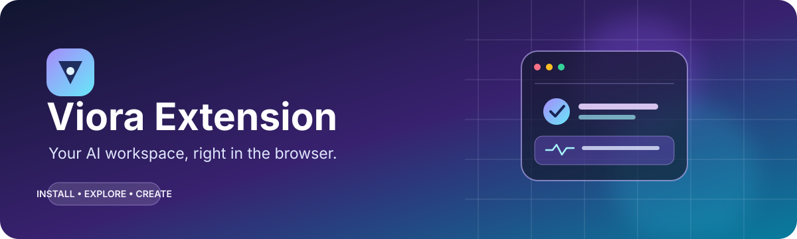
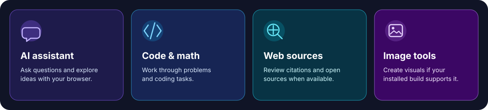

**Your AI workspace, right in the browser.**

Viora Extension is a browser-extension project for accessing AI assistance from your browser. The project includes downloadable extension packages and notes describing the intended direction: a clean AI interface for questions, coding and math help, web-search citations with source favicons, image-generation support, and multimodal/automation capabilities where configured.

> **Important:** Features depend on the version you install and the services configured for it. This repository contains ZIP packages; check the extension's interface and settings to see which features are available in your build.

## Feature overview

*This graphic illustrates the project's intended use cases, not a guarantee that every tool is enabled in every package.*

## Repository contents

- `viora-extension-7_5_0.zip` — the newer packaged extension in the repository root.
- `Extentions/viora-extension-6-1-😎-Best-VR.zip` — an earlier package.
- `Idea.txt` — project notes and intended features. It is planning material, not an installation guide.

## Install in Chrome or Microsoft Edge

1. Download the ZIP package you want from this repository. Start with **viora-extension-7_5_0.zip**.
2. Extract the ZIP file to a folder on your computer. Do not try to load the ZIP file itself.
3. Open your browser's extensions page:
   - **Chrome:** enter `chrome://extensions` in the address bar.
   - **Microsoft Edge:** enter `edge://extensions`.
4. Turn on **Developer mode**.
5. Select **Load unpacked**.
6. Choose the extracted folder that contains the extension's `manifest.json` file. If the folder you selected does not contain `manifest.json`, open the inner folder and select that instead.
7. If the browser reports an error, check the message on the extensions page and see [Troubleshooting](#troubleshooting).

The exact labels can vary slightly by browser version. Only install extension packages you trust.

## How to use Viora

1. After installation, find the Viora icon in your browser's extensions menu.
2. Pin the icon to your toolbar if you want quick access.
3. Click the Viora icon to open the extension.
4. Follow any first-run prompts or settings shown by your installed version.
5. Enter a question or task in the interface and submit it. If your build offers separate tools, choose the relevant tool for coding, math, search, or image generation.
6. For web answers, review the source links/citations when they are shown. Open the sources to verify important information.
7. If the extension provides provider or model settings, select a configured provider/model and save the settings before using that feature.

Not every package necessarily includes every capability described in the project notes.

## AI providers and API keys

The project notes mention DeepSeek models for reasoning and code, FLUX models for image generation, and NVIDIA Nemotron models for multimodal or automation features. Availability depends on the code in the package, provider access, and valid configuration.

- Use API keys that you obtain from the provider's official site.
- Add credentials only through a supported settings interface or a local environment/configuration method documented by the extension.
- **Never put API keys in this README, source code, screenshots, public issues, or Git commits.**
- If a real key was ever committed to the repository, revoke or rotate it with the provider and remove it from the code. Deleting it from the latest version alone does not erase it from Git history.
- Check each provider's terms, usage limits, and possible costs. “Free to use” does not guarantee that every connected model or API is free.

This repository's planning notes contain redacted credential placeholders. They are not usable API keys.

## Updating or reinstalling

1. Download the newer ZIP package.
2. Extract it into a new folder.
3. Open the browser's extensions page.
4. If Viora is already installed as an unpacked extension, use **Reload** after replacing its files, or remove the old unpacked entry and use **Load unpacked** on the new extracted folder.
5. Test the extension before deleting your previous folder.

Keep a backup of any local settings you need. Updating the extension may change how settings are stored.

## Troubleshooting

### “Manifest file is missing or unreadable”
You probably selected the ZIP file or the wrong folder. Extract the ZIP and select the folder that directly contains `manifest.json`.

### The extension does not appear
Confirm that it is enabled on the browser's extensions page. Open the extensions menu and pin the icon if needed.

### A feature or AI response does not work
Check your internet connection, the selected model/provider, and any required configuration. If the extension uses an API key, confirm that it is valid and has permission to access that model. Check the provider's service status and usage limits too.

### Search citations or favicons are missing
This feature must be implemented by the installed version and may depend on the search response providing source URLs. Try a fresh search and open the source links directly.

### The browser shows an extension error
Open the extensions page, locate Viora, and select **Errors** or **Details** if available. Read the error message before changing settings. When reporting a problem, include the browser and version, package version, steps to reproduce, and the error text—but never include API keys or other secrets.

## Privacy and security

AI features may send prompts, files, or other data to external providers depending on how the extension is implemented and configured. Review the extension's permissions and each provider's privacy policy before using sensitive information. Do not submit passwords, private keys, or confidential data unless you understand and trust the data handling.

Install only packages you trust, and review requested browser permissions before enabling the extension.

## Project status

This README explains the packages and general installation workflow based on the repository's available files and project notes. The notes describe desired capabilities; they do not by themselves prove that every feature is implemented in each ZIP. For feature-specific details, inspect the package's source files and settings.

## Contributing

When improving the project:

1. Keep setup instructions aligned with the actual extension files.
2. Never commit secrets or API keys.
3. Test installation in a clean browser profile.
4. Document any new permissions, provider setup, and known limitations.
